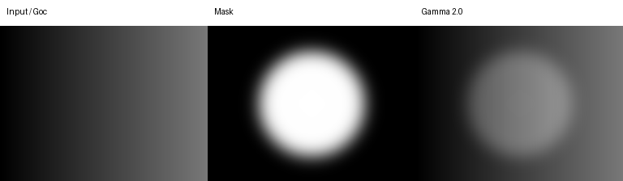

[English](algorithms.md) | [Tiếng Việt](algorithms.vi.md)

# Thuật toán cổ điển

Mốc: `02dd6f9`, đối chiếu ngày 2026-10-30. Năm thao tác planner là `denoise`, `gamma_correct`, `clahe`, `sharpen`, `color_correct`. Executor ánh xạ tên tool sang hàm Python. Phần mở rộng tùy chọn nằm ngoài pipeline MVP.

## Đo lường và quyết định

Measurement ước lượng sáng, nhiễu, độ nét, màu và lỗi khác; calibration ánh xạ phép đo sang mức độ. Bằng chứng VLM và ý định người dùng tham gia chẩn đoán. Bất thường đo được có thể là phong cách có chủ ý. Chẩn đoán chưa biến đổi pixel. Xem [measurement](../src/analyzer_evaluator/measurement) và [giới hạn planner](../src/agent/planner.py).

## Các phép xử lý

| Thao tác | Phương pháp và ý nghĩa tham số | Giới hạn chính |
|---|---|---|
| Denoise | Gaussian, median, bilateral hoặc NLM; sigma nhiễu mục tiêu = `12.5 * strength` theo thang 0–255 | Lọc mạnh mất texture; NLM tốn CPU hơn |
| Gamma | `out = 255 * (in / 255) ** (1 / gamma)` qua LUT 256 mức; gamma > 1 làm sáng, < 1 làm tối | Không phục hồi chi tiết cháy; nâng vùng tối lộ nhiễu |
| CLAHE | Cân bằng histogram thích ứng giới hạn tương phản trên LAB L (trực tiếp với grayscale); `clip_limit` giới hạn, `tile_grid_size` đặt lưới | Có thể khuếch đại nhiễu và thiếu tự nhiên |
| Sharpen | Unsharp cộng `amount * (image - blurred_image)`; có hỗ trợ Laplacian | Halo/nhiễu; không phục hồi tùy ý nhòe chuyển động |
| Color | Nhân saturation HSV và gain R/B theo temperature; shift dương làm ấm | Gain toàn cục khó sửa ánh sáng hỗn hợp |

Planner kẹp strength denoise 0.1–2.0, tương ứng sigma mục tiêu 1.25–25. Đây là quy ước tham số, không bảo đảm ước lượng nhiễu đúng. Unsharp dùng Gaussian sigma 2 pixel. Hệ số gain temperature là `20/128`: R `1 + k*t`, B `1 - k*t`. Xem source cho clipping, validation và grayscale.

Planner sắp thứ tự denoise → gamma → CLAHE → sharpen → color, nhằm giảm nhiễu trước phép tăng tương phản/độ nét. Miền tham số và guard giữ phong cách/chống chỉ định nằm trong planner, không suy từ diễn giải.

## Xử lý vùng

Ảnh RGB `uint8`; soft mask `float32` trong [0, 1], khớp kích thước không gian. Feathering giảm đường nối. Với mask M, ảnh đầu vào I và ảnh đã xử lý P:

$$O = M P + (1-M)I$$

Trọng số zero giữ pixel gốc; một chọn pixel đã xử lý. Wrapper chung `apply_region_op` đảm nhiệm blending và crop halo. Phép toán lân cận cần ngữ cảnh ngoài biên mask. Tạo vùng có thể dùng mask không gian, detector/landmark mặt hoặc semantic backend đã cài; xem bản ghi thực thi thực tế.

## Ví dụ và giới hạn

Với mặt ngược sáng, gamma cục bộ nâng chủ thể và soft mask giữ nền. Kiểm tra vị trí mask, chuyển tiếp biên, texture da và clipping sau xử lý. Đây là giải thích lựa chọn, chưa phải kết luận pipeline thành công qua đo lường.

Để tái lập hình trước/sau, chạy [script tạo hình](../scripts/generate_doc_figures.py). Gradient có kiểm soát dùng gamma 2.0 và mask tròn feather, minh họa hàm biến đổi/blending, không minh họa semantic detection. Hai bản dùng chung hình.

Xem [processing](../src/processing_engine), [region](../src/region_engine), [benchmark tham số hiện có](module3/benchmark/README.md) (tham khảo tiếng Việt).
