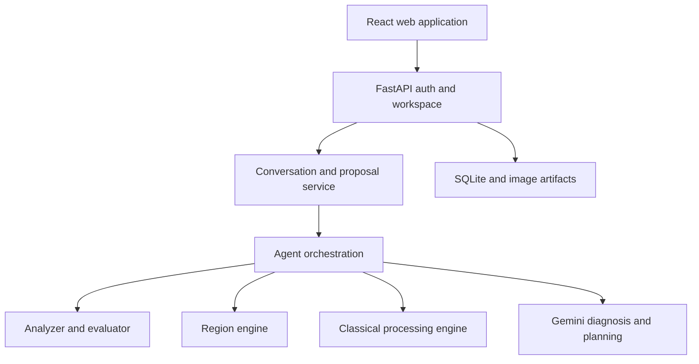
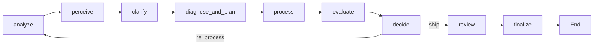

[English](architecture.md) | [Tiếng Việt](architecture.vi.md)

# Architecture

Implementation baseline: `02dd6f9`, inspected 2026-10-30. The source graph is authoritative when historical diagrams disagree.

## Boundaries

| Component | Responsibility | Source |
|---|---|---|
| Analyzer/evaluator | Measurements, calibrated severity, reference and no-reference evaluation | `src/analyzer_evaluator/` |
| Region engine | Spatial, face and semantic masks; feathering and blending | `src/region_engine/` |
| Processing engine | Denoise, exposure/contrast, sharpness and color | `src/processing_engine/` |
| Agent/API | Evidence fusion, intent, validated plans, execution, review, conversation and persistence | `src/agent/`, `src/api/` |

The React client uses authenticated workspace sessions. Upload decodes and applies EXIF orientation before diagnosis. A conversation can prepare a proposal without rendering pixels. `/execute` applies the displayed proposal revision with an idempotency key. This application workflow is distinct from calling `run_pipeline()` directly in Gradio or scripts.

## Closed-loop graph

See [graph source](../src/agent/graph.py), [state](../src/agent/state.py) and [session lifecycle](../src/agent/session.py). Clarification can interrupt for user input. The planner accepts a fixed toolbox and clamps parameters; preserve intent and contraindications constrain actions. Evaluation and decision logic bound the loop and can reject a harmful iteration. The default iteration budget is three; this is a safety bound, not a promise of improvement.

No Gemini key selects rule-based behavior. Call/parse/validation failure can produce `vlm_fallback`; a valid VLM response is labeled separately. Region capabilities depend on installed models. Record the actual mask/backend rather than assuming semantic segmentation succeeded.

## Storage and lifecycle

Workspace accounts, session metadata, conversations and results live in `data/app/app.sqlite`; image artifacts live under `data/app/users/`. Case memory is separate (`data/memory/cases.sqlite`) and stores case information rather than images. Waiting clarification threads use process memory, so restarting can require clarification again. Requests that execute processing are synchronous; do not interpret saved flow logs as live progress.

## Worked scenario: backlit portrait

1. Measure exposure and clipping, then inspect subject evidence.
2. Diagnose a dark subject and ask about intentional silhouette when needed.
3. Resolve a subject/face mask and preserve the bright background.
4. Plan a bounded local exposure action; gamma above one brightens in this implementation.
5. Apply the operation through soft-mask blending, evaluate side effects and keep or revise the result.

This scenario explains control flow; it is not a measured success claim. See [evaluation](evaluation.md) for evidence and [contracts](interfaces.md) for array formats.
