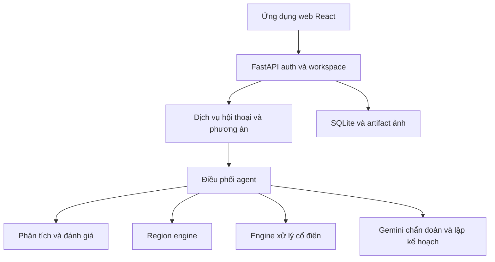
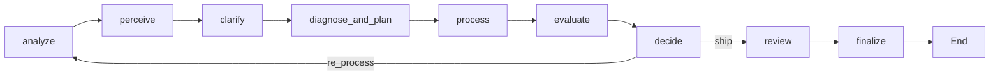

[English](architecture.md) | [Tiếng Việt](architecture.vi.md)

# Kiến trúc

Mốc implementation: `02dd6f9`, đối chiếu ngày 2026-10-30. Khi sơ đồ lịch sử khác code, graph nguồn là căn cứ.

## Ranh giới

| Thành phần | Trách nhiệm | Source |
|---|---|---|
| Analyzer/evaluator | Đo lường, mức độ lỗi hiệu chuẩn, đánh giá có/không tham chiếu | `src/analyzer_evaluator/` |
| Region engine | Mask không gian, khuôn mặt, semantic; feathering và blending | `src/region_engine/` |
| Processing engine | Khử nhiễu, sáng/tương phản, độ nét và màu | `src/processing_engine/` |
| Agent/API | Hợp nhất bằng chứng, ý định, phác đồ hợp lệ, thực thi, review, hội thoại và lưu trữ | `src/agent/`, `src/api/` |

React dùng phiên workspace có xác thực. Upload giải mã và xoay theo EXIF trước khi chẩn đoán. Hội thoại có thể chuẩn bị phương án mà chưa render pixel. `/execute` áp dụng đúng revision phương án hiển thị với idempotency key. Luồng ứng dụng này khác việc gọi thẳng `run_pipeline()` từ Gradio/script.

## Graph khép vòng

Xem [graph](../src/agent/graph.py), [state](../src/agent/state.py), [vòng đời phiên](../src/agent/session.py). Clarification có thể ngắt để chờ người dùng. Planner chỉ nhận toolbox cố định và kẹp tham số; ý định giữ phong cách và chống chỉ định ràng buộc thao tác. Đánh giá/quyết định giới hạn vòng lặp và có thể loại vòng gây hại. Ngân sách mặc định là ba vòng; đây là giới hạn an toàn, không bảo đảm chất lượng tăng.

Không có key Gemini thì chạy rule-based. Lỗi gọi/parse/validate có thể tạo `vlm_fallback`; kết quả VLM hợp lệ có nhãn riêng. Khả năng phân vùng phụ thuộc model đã cài. Ghi backend/mask thực tế thay vì mặc định semantic segmentation luôn thành công.

## Lưu trữ và vòng đời

Tài khoản, metadata phiên, hội thoại và kết quả nằm trong `data/app/app.sqlite`; artifact ảnh ở `data/app/users/`. Bộ nhớ ca riêng (`data/memory/cases.sqlite`) lưu thông tin ca thay vì ảnh. Thread hỏi ý chờ trong bộ nhớ tiến trình, nên restart có thể cần hỏi lại. Request thực thi là đồng bộ; flow log đã lưu không phải tiến độ trực tiếp.

## Ví dụ: chân dung ngược sáng

1. Đo sáng/cháy sáng, xem bằng chứng vùng chủ thể.
2. Chẩn đoán chủ thể tối và hỏi về silhouette có chủ ý nếu cần.
3. Tạo mask chủ thể/mặt, giữ nền sáng.
4. Lập thao tác sáng cục bộ có giới hạn; gamma lớn hơn một làm sáng trong implementation này.
5. Áp dụng qua soft-mask blending, đánh giá tác dụng phụ, giữ hoặc sửa kết quả.

Ví dụ giải thích điều khiển, chưa phải kết luận thành công qua đo lường. Xem [đánh giá](evaluation.vi.md) và [contract](interfaces.vi.md).
