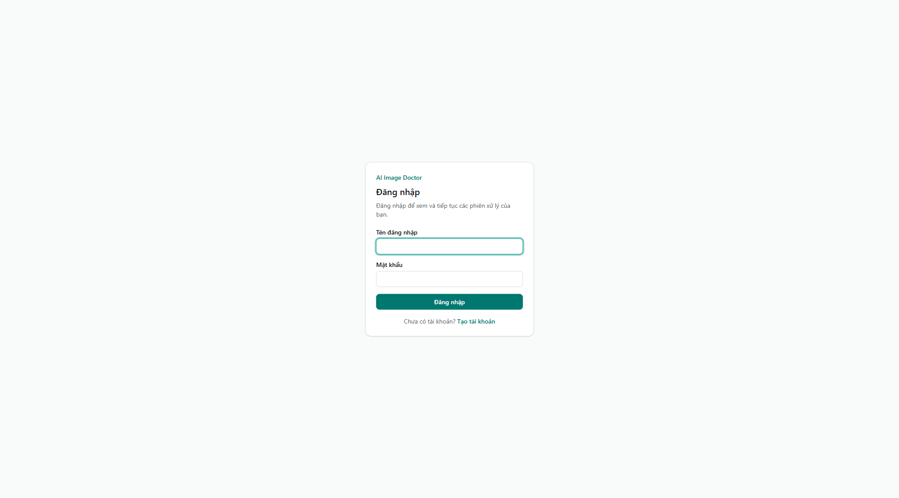
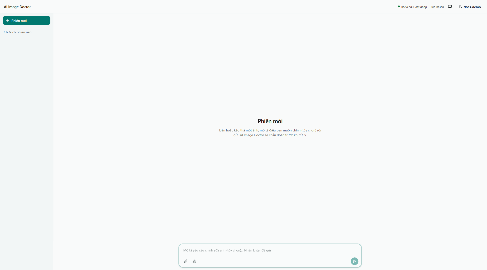
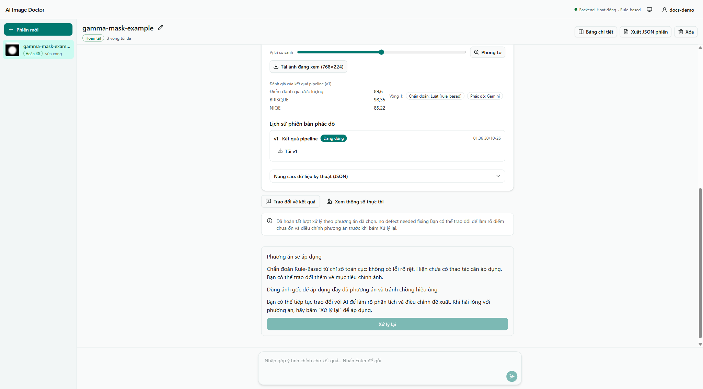

[English](user-guide.md) | [Tiếng Việt](user-guide.vi.md)

# Hướng dẫn sử dụng

Bắt đầu từ [quickstart](../README.vi.md). Hướng dẫn theo workspace hội thoại tại revision `02dd6f9`.

1. Đăng ký/đăng nhập, upload JPEG, PNG hoặc WEBP, hoặc chọn mẫu. Thiếu file mẫu có thể khiến danh sách rỗng.
2. Đọc phân tích, mô tả mục tiêu và phần cần giữ như nền/sắc ấm chiều tối. Trả lời câu hỏi khi được yêu cầu.
3. Thảo luận phác đồ. Chat chuẩn bị/cập nhật phương án, chưa render pixel.
4. Thực thi phương án hiển thị. Chờ request đồng bộ xong, xem thao tác thực tế và đầu ra.
5. So gốc/kết quả cùng zoom: nhiễu, halo, cháy sáng, texture da và thay đổi ngoài vùng đích.
6. Góp ý tinh chỉnh, xem phương án mới và thực thi khi phù hợp. Export kết quả chọn. Rating là chủ quan, không phải ground truth.

## Demo và xử lý lỗi

Dùng chân dung ngược sáng được phép sử dụng: “Làm sáng mặt nhẹ và giữ nền.” Xem vùng đề xuất, thực thi, kiểm tra chi tiết mặt/nền. Yêu cầu giảm chỉnh nếu da phẳng. Trình bày cả thất bại/không đổi khi giải thích giới hạn.

Nhãn nguồn phân biệt rule-based, VLM và VLM fallback. Điểm nội bộ là ước lượng, không phải phần trăm chính xác. Có key chưa chứng minh Gemini chạy. Thread hỏi ý hết hạn có thể cần hỏi lại sau restart. Phiên bận phải xong trước thao tác không tương thích. Xem [giới hạn upload](api.vi.md). Flow log đã lưu không phải tiến độ streaming.

## Màn hình hiện tại

Chụp từ bản build cục bộ ngày 2026-10-30. Đã upload hình tổng hợp để smoke test đăng ký, chẩn đoán và thực thi phác đồ rỗng. Đây là bằng chứng điều hướng, không phải chất lượng phục hồi. UI hiện “Phác đồ: Gemini” cho kết quả rỗng dù server rule-based; riêng nhãn đó không chứng minh có gọi Gemini. Walkthrough ảnh thật đầy đủ gồm tinh chỉnh/export và renderer Markdown/Mermaid chưa được kiểm chứng. Xem [kiểm chứng](documentation-verification.vi.md).
